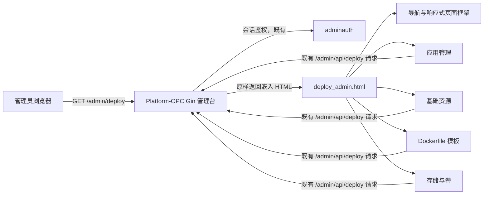

# Loop 1 Architecture：Deploy-OPC 左侧导航

## 已确认约束

- 采用固定左侧导航和右侧工作区，沿用现有浅色卡片式风格。
- 桌面侧栏宽 224px；窄屏收为图标栏；手机使用抽屉，不退回顶部横向 Tab。
- 四个模块、既有业务操作、接口、数据、权限均不变。
- 页面切换不整页刷新，URL hash 可恢复当前模块。
- 交付到 `release`，按现有 SOP 部署测试与正式环境。

## 已验证事实

- `main.go` 的 `/admin/deploy` 路由在既有管理台会话鉴权后，从 `pkg/web` 的嵌入文件系统读取 `deploy_admin.html` 并原样返回；没有服务端 HTML 模板逻辑。
- `pkg/web/embed.go` 已包含 `deploy_admin.html`，单文件修改会进入现有 Go 二进制和 Docker 镜像。
- 页面使用 Vue 3 全局构建与 Tailwind CSS，无独立前端包管理或构建步骤。四个业务模块已经由 `activeTab` 和 `v-if` 隔离。
- 现有概览卡、四个业务区、弹窗和抽屉均位于同一 HTML；现有 API 调用可保持不变。
- 当前没有 `location.hash` 或 `hashchange` 处理，也没有针对 `deploy_admin.html` 的 Go 自动化测试。
- 标准验证命令为 `go test ./...` 与 `go build .`；生产镜像使用 `docs/deploy/Dockerfile`，运行编排和回滚以 `docs/deploy/SOP.md` 为准。

## 目标架构与模块边界

依赖方向保持为浏览器 UI → 既有 Gin 管理台 → 既有业务服务。本轮只在 UI 内增加导航状态适配，不引入反向依赖或新服务。

### 页面框架

- 根布局改为“固定侧栏 + 内容列”。内容列在中屏预留 72px、在大屏预留 224px，手机不预留侧栏宽度。
- 断点复用 Tailwind 默认值：`lg`（≥1024px）显示完整侧栏，`md`（768–1023px）显示 72px 图标栏，`<768px` 默认隐藏侧栏并由顶栏按钮打开抽屉。
- 手机抽屉带遮罩、关闭按钮和 Escape 关闭；选择模块后自动关闭。侧栏层级低于既有业务弹窗的 `z-50` 冲突需避免：手机导航使用 `z-40`，遮罩使用 `z-30`，既有业务弹窗继续保持更高层级。
- 右侧顶栏显示当前模块标题和既有“刷新数据”；同步控制台与系统导航移入侧栏底部。
- 原顶部 Tab 条删除。模块新增和存储刷新按钮移到对应工作区右上方，四个业务区内部结构保持不变。
- 概览卡改为四列仅在 `xl` 以上启用，避免完整侧栏挤压卡片；表格继续使用既有横向滚动容器。

### 导航状态

- 合法模块标识固定为 `apps`、`resources`、`templates`、`storage`，hash 形式分别为 `#apps`、`#resources`、`#templates`、`#storage`。
- `selectTab(tab)` 是菜单和概览卡的唯一切换入口：校验模块、更新 `activeTab`、同步 hash，并在进入存储模块时调用既有 `loadStorageData()`。
- 初次挂载读取合法 hash；缺失或非法值回退到 `apps` 并修正 hash。监听 `hashchange`，使用户手工修改 hash 时工作区同步。
- hash 使用 `history.replaceState` 同步，避免每次切换制造浏览器历史记录；hash 变化不触发整页加载。
- 当前菜单由同一 `activeTab` 派生高亮和 `aria-current="page"`，避免概览卡与菜单状态分叉。

## 部署拓扑与回滚

- 交付提交先推送到 `release`，服务器拉取该分支并以 7 位提交号构建 `platform-opc:<commit>`。
- 测试与正式环境均先记录当前容器、镜像和部署目录，保留服务器现有配置及未提交改动。
- 仅替换 Platform-OPC 服务镜像并重建对应容器；不重建共享数据库、对象存储或其他业务服务。
- 部署后核对镜像标签、容器状态、启动日志、`/admin/login` 和 `/admin/deploy` 鉴权行为，并在登录会话中验证四个导航模块。
- 回滚使用部署前记录的旧镜像：`PLATFORM_OPC_TAG=<旧commit> docker compose up -d`；若现场为其他编排形态，以现场只读盘点为准，不套用 SOP 假设。

## 数据模型与兼容

**本轮不涉及数据模型变更。** 不新增、修改或删除表、字段、索引和约束，不执行数据迁移，因此没有存量数据处理或数据库回滚步骤。页面 hash 仅作为无持久化的前端导航状态；旧的无 hash 地址继续打开应用管理，兼容现有入口。

## 决策分类与待决问题

- 已确认约束：上述布局、响应式方向、hash 恢复和不改业务行为。
- 已验证事实：上述代码嵌入、Vue 状态、测试缺口和 SOP 入口。
- 已选定技术方案：单 HTML 实现，集中 `selectTab`，Tailwind 响应式断点，无新依赖。
- 待决问题：无。现场部署路径和当前镜像须在部署前只读核实，不属于产品方案待决项。

## 确认留痕

确认人：杨晶（`yj198788@hotmail.com`）  
确认时间：2026-11-23  
确认版本：首版技术方案，与 issue 中已确认的 224px 左侧导航、右侧工作区、hash 恢复及响应式方向一致；需求基线提交 `7da9cfd`。本文只补充技术实现和部署事实，没有新增产品决定。
